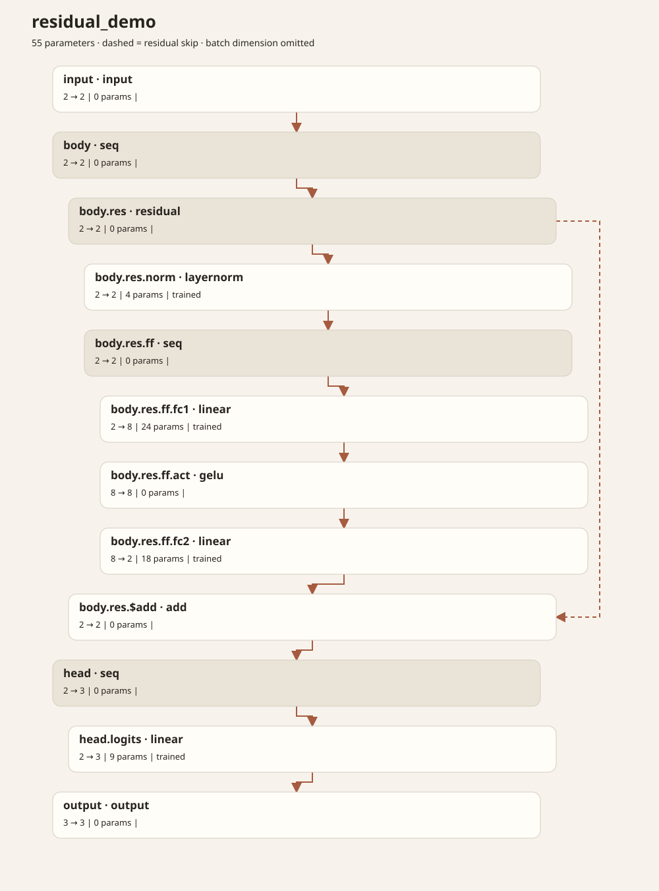

# wgt: native project and package tooling

`weightc` is the compiler. **`wgt` is a separate Rust executable**, inspired by
Cargo's project workflow and external subcommands. This implementation is on
main; it is not part of the published weightc 0.2.0 Python wheel or a published
wgt binary release.

## Install

```sh
cargo install --path crates/wgt --locked
wgt --help
wgt --list
wgt doctor
```

The installed executable does not embed, import, or invoke Python for package
management, artifact verification or graph rendering. HTTPS uses Rust's reqwest
and rustls. Remote tag resolution uses `git`; uploading releases uses `gh`.

`build`, `run`, `check` and `test` invoke the existing **weightc** compiler.
That compiler currently depends on Python/PyTorch. Install it separately, or set
`WEIGHTC=/absolute/path/to/weightc`. A missing compiler produces a clear error;
`wgt` never silently installs a Python environment.

## Project workflow

```sh
wgt new demo                   # creates demo/wgt.mod, main.wgt and tests/main.json
cd demo
wgt check                      # parse/type-check every root .wgt, including libraries
wgt build                      # compile model files into build/; executes training directives
wgt run --input '[[0,1]]'       # builds main.wgt, then infers
wgt test                       # runs tests/*.json behavior assertions
wgt graph build/demo --open
```

`wgt init` initializes an existing directory. Neither creation command overwrites
existing project files. The starter trains a small linear identity map on four explicit rows; its
behavior test checks two of those rows within an absolute tolerance of 0.001.
This is a toolchain example, not a held-out generalization benchmark.

`-C DIR` selects a directory; project commands search upward for `wgt.mod`.
Source paths for build/check/run are relative to the discovered project root.
Use `wgt build model.wgt` or `wgt run --source model.wgt --input '[1,2]'`
to select a source. Building always calls the compiler; there is no incremental
training cache yet.

## Dependencies

```sh
wgt add github.com/WeightLang/WeightLang/packages/gates --version v0.2.0
wgt tree
wgt metadata
wgt fetch
wgt fetch --locked
wgt build --offline --locked
wgt update github.com/WeightLang/WeightLang/packages/gates --version v0.2.0
wgt remove github.com/WeightLang/WeightLang/packages/gates
```

These commands retain the existing **wgt.mod / wgt.sum** formats and
`WEIGHTLANG_CACHE` location. Existing consumers and `weightc` keep working.
Add/update fetch successfully before changing project metadata, preserve
comments in the manifest, and retain immutable hash checks for known versions.
Remove does not rewrite source imports.

`fetch` verifies the tag's commit, release index, every asset's exact byte size
and SHA-256, and the tagged source against the artifact source. It validates
safetensors headers, tensor shapes, dtype, origins, and contiguous data ranges.
A module is staged and installed only after verification. Native clients
sharing the same cache serialize mutations with an advisory lock.
The lock hashes use trust on first use, not publisher signatures.

`--offline` never contacts the registry. All required files must already be
locked and cached. `--locked` prohibits dependency edits and lock changes.
Normal builds reuse verified cached packages; when dependencies are absent,
they fetch unless offline. Explicit fetch rechecks remote tags.

Current scope: **exact versions and direct GitHub dependencies**. This is
Cargo-like command ergonomics, not Cargo's full feature set: no semver solver,
transitive dependencies, workspaces, central registry or feature unification.
`update` therefore requires an explicit version; it never guesses “latest”.

## Behavior tests

Each `tests/*.json` file declares a source, input, expected numerical output and
optional absolute tolerance (default `1e-6`):

```json
{
  "source": "main.wgt",
  "input": [[0, 1], [1, 0]],
  "expected": [[0, 1], [1, 0]],
  "atol": 0.000001
}
```

Each model builds once per test invocation. Shape or value mismatches fail the
command with a nonzero exit status. These are numerical assertions, not inferred
training-quality claims.

## Packaging and publishing

From a committed, clean package directory whose module path matches its Git
location:

```sh
wgt build
wgt package --version v0.1.0 --artifacts build -o dist
wgt publish --index dist/wgt.index.json --dry-run
# Push the exact commit and annotated package tag shown in the index, then:
wgt publish --index dist/wgt.index.json
```

`package` consumes **prebuilt** artifacts and needs no Python. It checks source
hashes against local committed .wgt files, rejects untrained tensors by default,
and writes the same release assets/index as `weightc publish`. Output must be
empty. `--allow-untrained` is an explicit experimental escape hatch and does
not alter provenance. Packages with dependencies cannot be published yet.

`publish` checks the existing remote tag matches the index commit and invokes
`gh release create --verify-tag --prerelease`. It does not create/push tags,
overwrite releases, or claim the CLI's Latest slot. Dry-run uploads nothing.
Ignore build/ and dist/ in the package's Git configuration.

## Native architecture rendering

One command renders HTML and opens the default browser:

```sh
wgt graph build/demo --open
```

Without `-o`, output goes to `<system temporary directory>/weightlang/model.<format>`
(on Linux, normally `/tmp/weightlang/model.html`). The same file is atomically
replaced on each invocation. Temporary filenames do not accumulate per model or
run. The command prints the resulting path. `--open` is supported for HTML and uses
the platform's default opener; if no graphical session is available, the command
reports failure and retains the generated file.

Use `--stdout` for pipes or agents, e.g.
`wgt graph build/demo --format json --stdout`. It conflicts with `-o` and `--open`.


```sh
wgt graph build/demo --format html -o model.html
wgt graph build/demo --format svg -o model.svg
wgt graph build/demo --format md -o model.md
wgt graph build/demo --format json -o model.json
wgt graph build/demo --format toon -o model.toon
wgt graph build/demo --format mermaid --stdout
wgt graph build/demo --format dot --stdout
```

Input is an artifact directory or its manifest.json. All artifact hashes and
tensor layouts are verified before rendering. Rendering does not execute
models, train them, or need Python, Graphviz or a CDN.

- **HTML:** standalone diagram plus expandable tensor/provenance and JSON views.
- **SVG:** a directly viewable, self-contained vector diagram.
- **Markdown:** Mermaid flowchart and readable layer table.
- **JSON:** versioned `weightlang.graph` schema with nodes, edges and tensors.
- **TOON:** the same graph data using counted tabular arrays, targeting the
  [TOON 4.4 specification](https://github.com/toon-format/spec/blob/main/SPEC.md).
- **Mermaid / DOT:** source for other diagram tools.

Dotted paths and parent fields retain block nesting. Residuals have explicit
add nodes and skip edges. Widths omit the optional batch dimension. Shapes in
the tensor table use `2x8` notation. Scalar parameters are counted exactly once
at leaf tensors; block boundary nodes own zero. Origins are displayed, not
inferred from parameter values. Explicit `-o` output files must not already exist; default temporary outputs are replaced.

A rendered example from [examples/residual.wgt](../examples/residual.wgt):



## Extensions

Put an executable named `wgt-hello` on PATH:

```sh
#!/bin/sh
printf 'Hello from %s\n' "$WGT_PROJECT_DIR"
```

`wgt hello arg1 arg2` executes it with `arg1 arg2` as separate arguments and
preserves its exit code. Built-ins take precedence. Global `-C` sets the working
directory. `WGT_PROJECT_DIR` is provided when a project is found;
`WGT_OFFLINE` and `WGT_LOCKED` are `1` or `0`. Plugins are ordinary trusted
executables, not sandboxed; they must implement those flags themselves.
`wgt --list` lists installed extensions. No plugin registry or Python entry-point
system is required.

## Local checks

```sh
cargo test --locked
cargo fmt --check
cargo clippy --all-targets --locked -- -D warnings
```
