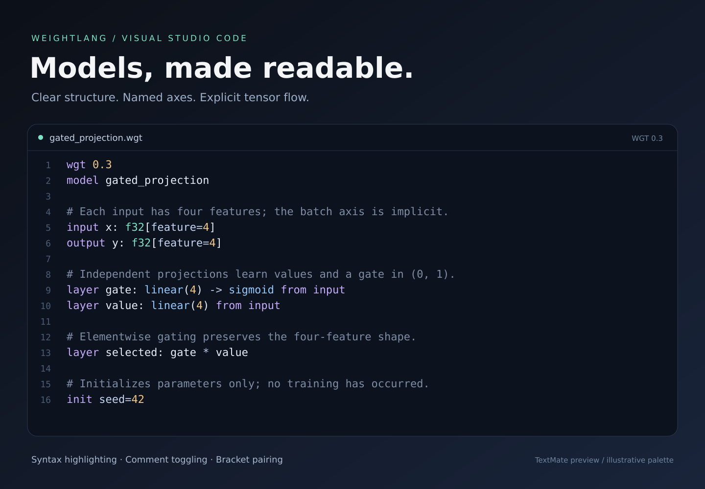

  

<h1 align="center">WeightLang</h1>

<strong>Models, made readable.</strong> Syntax highlighting for explicit neural network programs.

Write and review `.wgt` models with clear keywords, tensor types, named axes,
operators and graph connections. WeightLang describes the model; Python owns the
application, data and training loop.

## A small extension, a clearer model

| Feature | What you get |
| --- | --- |
| Syntax highlighting | Keywords, built-in operators, types, numbers, strings and comments |
| Tensor expressions | Named axes, graph connections, loops and multiline expressions |
| Editing essentials | Toggle `#` comments; pair brackets, parentheses and double quotes |
| Theme support | Standard TextMate scopes follow your current color theme |
| Offline by design | No runtime dependencies, telemetry, network requests or executable extension code |

The preview uses this extension's actual TextMate tokenizer and an illustrative
dark palette. Your editor's theme determines the final colors.

## Get started

Open a `.wgt` file. The language mode changes to **WeightLang** automatically.
If needed, select **WeightLang** from the language picker in the status bar.

No Python or PyTorch installation is required for highlighting. To check or run
models, install the separate [WeightLang toolchain](https://github.com/WeightLang/WeightLang).

## Scope

This extension covers the declarative WGT syntax implemented in the WeightLang
repository, including WGT 0.3 constructs. Highlighting is lexical: it does not
validate language versions or shapes, train models, or provide completion,
definition navigation or diagnostics. Experimental `backend torch-dynamic`
Python-like function bodies are not supported.

## 中文说明

为 `.wgt` 模型文件提供语法高亮、`#` 注释切换和括号配对，配色跟随当前主题。
安装后直接打开 WGT 文件即可，不需要运行 Python 或加载模型。
目前不含自动补全、定义跳转和实时错误诊断。

[Language reference](https://github.com/WeightLang/WeightLang/blob/main/docs/reference.zh-CN.md)
· [Report an issue](https://github.com/WeightLang/WeightLang/issues)
· [Other editors](https://github.com/WeightLang/WeightLang/blob/main/docs/editors.md)

## Local installation

Use **Extensions: Install from VSIX** to install a locally built package.
See [BUILD.md](BUILD.md) for development and packaging instructions.
