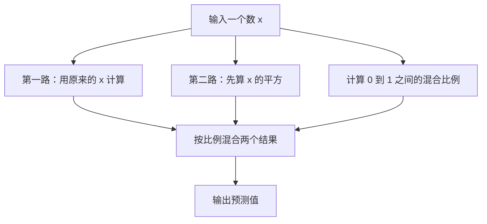

# 第一堂课：亲手设计一个两条路线的神经网络

你负责规定数据怎样计算，训练负责调整计算中的数字。这一课会做出一个只有 6 个可训练数字的小网络：输入一个数，同时走两条计算路线，再按一个可学习的比例混合结果。

这是一项可以检查答案的小实验，用来学习设计结构、训练、保存和预测。它不是语言模型，也不以研究创新或优于成熟架构为目标。

## 先确认版本

本课使用 [Python SDK PR #7](https://github.com/WeightLang/WeightLang/pull/7) 的固定提交 [`9783978`](https://github.com/WeightLang/WeightLang/commit/978397867a1c8bd8cfd84a3811968a2c01f98c13)。编写时（2026-11-09，台北时间）该 PR 尚未合并，SDK 尚未发布到 PyPI。只安装当时的主分支或运行 `pip install weightlang`，不能保证得到本课所用的接口。

SDK 把 `model.wgt` 的计算结构交给普通 PyTorch 模型；数据、训练循环和保存操作写在 Python 中。环境及依赖交给 uv，误差反传及参数更新交给 PyTorch。这里没有重新实现环境管理器或训练引擎。

## 1. 先看这张“计算路线图”



例如，第一条路线算出 2，第二条算出 6，混合比例为 0.25，最后就算 `0.25 × 2 + 0.75 × 6 = 5`。比例也能通过训练调整。

“结构”指这几条路线以及它们怎样连接。“参数”指路线里的可调整数字。“训练”指根据例题的误差调整参数。“推理”指用调整好的参数计算一个新输入。

两条路线每次都会计算。这是软混合，不是只运行其中一条路线。结构由你写定；本课的训练不会自动增加路线、替换公式或发明新结构。

## 2. 第一次准备环境

下载教学包并解压，打开终端，进入包含 `model.wgt`、`learn.py`、`predict.py` 的文件夹：

```sh
cd weightlang-first-custom-network
```

本课当前需要已安装 [uv](https://docs.astral.sh/uv/getting-started/installation/)、[Git](https://git-scm.com/downloads) 和 [Rust / Cargo](https://www.rust-lang.org/tools/install)。Rust 用来构建这个尚未发布的版本的 WGT 编译器，只需准备一次。Python 由 uv 选择和管理，不用自己创建全局 Python 环境。

依次运行下面三条命令。每条都在同一个教学目录中执行，等上一条结束再执行下一条：

```sh
uv venv --python 3.12
uv pip install --torch-backend auto numpy "weightlang @ git+https://github.com/WeightLang/WeightLang.git@978397867a1c8bd8cfd84a3811968a2c01f98c13#subdirectory=python"
cargo install --locked --git https://github.com/WeightLang/WeightLang.git --rev 978397867a1c8bd8cfd84a3811968a2c01f98c13 --root .tools --bin wgt weightlang-wgt
```

第一条创建本项目自己的 Python 环境；第二条让 uv 选择 PyTorch 安装后端并安装 SDK；第三条把匹配的 WGT 编译器装进本目录的 `.tools`。脚本会自动使用这个编译器，不必改系统 PATH。

首次安装需要联网，PyTorch 下载及 Rust 构建可能较久。若设备已经安装了同一提交的 SDK 和编译器，可以复用已有环境；否则按上面的固定版本准备，避免编译器与 SDK 不一致。`numpy` 用来避免当前 PyTorch 在缺少 NumPy 时发出的初始化提示，本例的数学运算仍由 PyTorch 完成。

运行时 `device="auto"` 按 CUDA、XPU、MPS、CPU 的顺序检查可用设备。没有可用加速设备也能使用 CPU。本课已经在 CPU 上实际验证，没有在 GPU 上做本课的验收。

## 3. 看懂你自己决定的结构

打开 `model.wgt`。前面几行声明每份输入和输出都是一个数：

```wgt
input x: f32[1]
output y: f32[1]
```

`f32` 是存放小数的类型，`[1]` 表示每份样本有一个数。Python 会把 65 份样本排成 `[65, 1]`，每一行是一道题。不要把“有 65 份题目”误写成“每道题有 65 个特征”。

六行 `parameter` 声明六个可训练数字。它们旁边的 `[0.3]`、`[0.1]`、`[0]` 是开始训练前的初值。

真正决定计算路线的是这一段：

```wgt
fn forward(x) {
    let line = x * w_line + b_line;
    let curve = (x * x) * w_curve + b_curve;
    let blend_ratio = sigmoid(x * w_gate + b_gate);
    return blend_ratio * line + ([1] - blend_ratio) * curve;
}
```

- `line`：把原数乘一个可训练数字，再加一个可训练数字。
- `curve`：先把原数平方，再乘、加另外两个可训练数字。
- `sigmoid`：把一个计算结果转换为 0 到 1 之间的比例，方便混合。
- 最后一行：按照比例，把两个结果加起来。

`x * x` 是你放进结构里的计算规则，不会在训练时被替换。`w_curve` 等六个参数的数值会被调整。这就是“设计网络”和“训练网络”的分工。

本例属于已有的软门控融合思路。亲手设计自己的计算图并不要求先证明世界上没人做过同样的设计。

## 4. 给它出题，再训练

这一课的正确答案由下面的规则产生：

```text
答案 = 2 × x × x + 0.5 × x + 1
```

例如，输入 `0.5`，正确答案就是 `1.75`。规则集中写在 `learn.py` 的 `answer(x)` 函数中。真实任务通常没有现成的公式，应提供实际样本及对应答案；这堂课使用公式，是为了容易核算结果。

现在运行：

```sh
uv run --no-project python learn.py
```

程序会生成 65 份训练题目，在 `[-1, 1]` 区间内训练 1000 步，再用 64 个没有参加训练的中点做检查，最后保存到 `weights/first/`。这里的一步是用整批 65 份题目做一次参数更新。

训练的核心只有这五行，它们已经写在文件里，不需要你再复制一遍：

```python
optimizer.zero_grad(set_to_none=True)
prediction = model(x)
loss = criterion(prediction, y)
loss.backward()
optimizer.step()
```

依次做的是：清掉上一轮的梯度；计算预测；计算误差；求出参数变化会怎样影响误差；按优化器的规则调整参数。`criterion` 是 PyTorch 的平均平方误差，`optimizer` 是 PyTorch 的 Adam。一次更新不保证误差一定下降，应观察整个训练过程和未参加训练的检查题。

平均平方误差的算法是：每道题先计算“预测减答案”，把差平方，再对所有题目求平均。它是误差大小，不是准确率；不能把 `0.00017` 当成“准确率 99.983%”。

## 5. 对照一次真实运行

本课使用 Python 3.12.14、PyTorch 2.15.0+cpu、上述固定 SDK 版本，在 CPU 上跑出了以下结果；不同环境可能有小幅数值差异。

| 检查项 | 实测结果 |
| --- | ---: |
| 可训练数字 | 6 |
| 训练步数 | 1000 |
| 训练前平均平方误差 | 3.18026876 |
| 训练后平均平方误差 | 0.00017169 |
| 未参加训练的中点误差 | 0.00015146 |
| 保存后重新加载的预测 | 核对一致 |

| 输入 | 正确答案 | 模型预测 |
| ---: | ---: | ---: |
| -1.00 | 2.50000 | 2.47629 |
| -0.50 | 1.25000 | 1.26209 |
| 0.00 | 1.00000 | 0.98678 |
| 0.50 | 1.75000 | 1.75858 |
| 1.00 | 3.50000 | 3.45584 |

这些结果说明这个具体小网络学到了这个小任务的一种近似解。检查点仍在 `[-1, 1]` 内，属于区间内插值检查；它们没有验证区间外输入或真实数据上的表现，也不能证明门控是完成这道题所必需的。

事实上，把比例固定为 0.5，第一路设置为 `x + 1`，第二路设置为 `4*x*x + 1`，也能正好得到答案。训练后不必得到这一组参数；多组参数可以给出相近预测。这个实验展示的是设计、训练和验证的过程。

包内 `verification/cpu-metrics.json` 是本次运行记录，供对照；它不是已经装进模型的知识。教学包不附带训练后的模型，你运行 `learn.py` 才会生成自己的 `weights/first/model.pt`。

## 6. 用训练好的网络回答一个问题

仍在同一个目录里执行：

```sh
uv run --no-project python predict.py 0.5
```

本次实际输出为：

```text
输入：0.5；预测：1.758576；设备：cpu
```

正确答案是 `1.75`，所以这个预测已经接近答案。你也可以换成 `0.25` 或 `-0.6`，先在训练区间内试。

`predict.py` 读取的是 `weights/first/model.pt`，其中保存了结构和训练后的参数。重新读取 `model.wgt` 会从声明的初值构建一个新的模型，不能代替读取训练结果。保存文件没有优化器进度，不是完整的断点续训存档。

## 7. 现在改成你自己的想法

第一次只改一处，保留题目、训练步数和检查方法。比如把第二条路线从“先平方”换成“先做 tanh 变换”。打开 `model.wgt`，将：

```wgt
let curve = (x * x) * w_curve + b_curve;
```

改为：

```wgt
let curve = tanh(x * w_curve + b_curve);
```

`tanh` 会把结果压到 -1 与 1 之间，这是另一种计算规则。改完以后，训练成一个新模型：

```sh
uv run --no-project python learn.py --output weights/second
uv run --no-project python predict.py 0.5 --model weights/second/model.pt
```

比较两次 `metrics.json` 的检查误差。这个改动可能变好，也可能变差；保持其他条件相同，才能判断结构变化在这道题上带来了什么效果。它不是“越特殊就越好”的比赛。

已有目录不会被覆盖。如果再做第三次实验，使用 `--output weights/third`。修改 `model.wgt` 不会改变已经保存的旧 `.pt`；想试新结构，就训练新模型并在预测时选择对应文件。

今后有新想法时，先回答四个问题：

1. 输入是什么，输出是什么？例如“一个数进，一个数出”。
2. 中间要做哪些计算，数据怎样流动？先用纸画出路线。
3. 哪些数字交给训练调整？它们需要成为参数，并且实际参与输出计算。
4. 用哪些没参加训练的例题，判断它是否比原来的结构更合适？

这一版 SDK 支持由已有算子组成的纯前向计算。它还不接受任意 Python 代码、可变状态和依赖输入的动态控制流；若想“根据输入选路”，第一课可以先使用本例的连续混合比例。设计需要新运算时，先检查实现是否支持，不能只写一个新名字就认为能够训练。

## 出错时先看这三处

- 找不到 `weightlang`：确认在教学目录中创建了环境，并用这里的 `uv run --no-project ...` 命令运行。SDK 要按固定提交从源码安装。
- 找不到编译器或提示目标不支持：确认匹配的编译器已经安装到教学目录的 `.tools`，不能用旧版 `wgt` 代替。
- 提示输出目录已存在：用 `--output weights/second`，保存为另一次实验；预测时同步选择相应 `.pt` 路径。

## 实现与资料

- [本课源码](https://github.com/WeightLang/WeightLang/tree/docs/first-custom-network/python/examples/two_ways)
- [固定版本 SDK 使用说明](https://github.com/WeightLang/WeightLang/blob/978397867a1c8bd8cfd84a3811968a2c01f98c13/docs/python-sdk.md)
- [固定版本的加载、保存和设备选择](https://github.com/WeightLang/WeightLang/blob/978397867a1c8bd8cfd84a3811968a2c01f98c13/python/weightlang/api.py)
- [PyTorch：构建神经网络](https://docs.pytorch.org/tutorials/beginner/basics/buildmodel_tutorial.html)
- [PyTorch：自动微分](https://docs.pytorch.org/tutorials/beginner/basics/autogradqs_tutorial.html)
- [uv 与 PyTorch 的集成](https://docs.astral.sh/uv/guides/integration/pytorch/)

验证范围：固定版本编译器的源码构建、WGT 编译、实际前向与梯度训练、独立 uv 环境安装、区间内检查、保存重载、单独预测。GPU 执行、各平台首次安装和上述 tanh 改动的训练效果不包含在原始两路模型的验收结果中。
